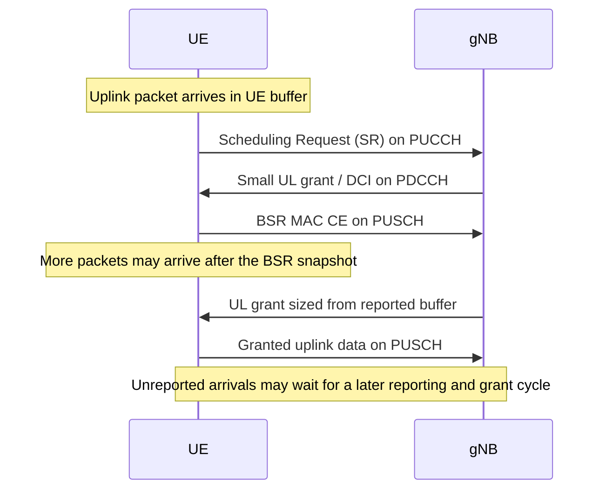
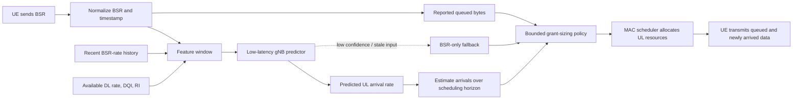
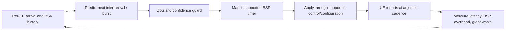

# Predicting Buffer Status Reports for 6G Uplink Scheduling

## Executive summary

A Buffer Status Report (BSR) tells the base station how much uplink data is queued when the report is generated. Packets arriving after that instant are invisible to the scheduler until a later report, so they can incur another scheduling cycle of delay. The source thesis studies whether a base station can predict the UE's short-term uplink data-arrival rate from recent BSR history and radio observations, then use that prediction to anticipate the additional bytes.

The thesis evaluates Random Forest (RF), XGBoost, and Long Short-Term Memory (LSTM) predictors on real-network traces. In its combined dataset, RF and XGBoost reached an MAE of 39.23 and 38.70 bit/ms, respectively; RF had the lowest RMSE (57.89 bit/ms), while XGBoost trained much faster in the reported experiment. Downlink data improved the tree-model results. These are **prediction results, not measured latency or 6G system gains**: the thesis did not implement the predictor in an end-to-end scheduler or report latency savings.

This brief turns that evidence into a 6G RAN integration proposal. It separates the thesis-supported idea (predict arrivals to improve grant sizing) from a complementary project extension (use predicted inter-arrival times to adapt BSR periodicity). A 12-week relative delivery plan is suggested because the thesis specifies no implementation deadline.

## Source and evidence boundary

- **Primary source:** Qi Zhang, *Predicting Buffer Status Report (BSR) for 6G Scheduling using Machine Learning Models*, KTH thesis, 2021. [PDF in this repository](Predicting_Buffer_Status_Report_In_6G.pdf) (source revision: [`5cb59f3`](https://github.com/rajibdash/ML-Aided-Dynamic-BSR-Periodicity-Adjustment-for-Enhanced-UL-Scheduling/blob/5cb59f372b93b7edc31353e600d0b1067c703bc2/docs/Predicting_Buffer_Status_Report_In_6G.pdf)).
- **Thesis evidence:** measured prediction error, model training time, and feature comparisons from the thesis's offline experiments.
- **Proposal in this document:** scheduler integration, adaptive periodicity control, deployment safeguards, and delivery milestones. These are recommendations, not experimental results or standardized 6G features.

## 1. Problem and opportunity

In the conventional grant-based uplink sequence, the UE first requests resources, sends a BSR after receiving a small grant, and then transmits the data sized by the gNB from that BSR. The BSR is a snapshot: packets that arrive after it was sent cannot be included in that snapshot. The UE may therefore have to wait for a later BSR/grant cycle. The thesis identifies the gap between BSR transmission and data transmission—including grant-processing and scheduling timing—as the opportunity for prediction.

### Baseline signal flow



The source discusses periodic and padding BSR timing. It denotes the grant-to-transmission timing by `tK`, the one-way transmission delay by `tT`, and the periodic-BSR interval by `tP`. In its simplified timing discussion, a padding BSR can be separated from the previous BSR by approximately `tK + 2*tT`; a periodic BSR follows the configured periodic timer. The exact timing model and terminology must be mapped to the applicable 6G frame structure and standards before implementation.

### BSR concepts relevant to the design

- **Logical Channel Groups (LCGs):** BSRs aggregate logical-channel buffer information by group rather than reporting every logical channel individually.
- **Short and long BSRs:** the thesis describes a short report for one LCG and a long report covering four LCGs.
- **Regular BSR:** triggered by buffer changes, including data arriving into an empty buffer or higher-priority data arriving while a report/grant is pending; a retransmission timer supports recovery when a grant is not received.
- **Padding BSR:** can use otherwise spare grant capacity to report buffer status.
- **Periodic BSR:** refreshes the network's buffer view when the periodic timer expires.

These details are background from the thesis and its cited LTE-era MAC description, not a normative specification for a future 6G BSR. A 6G design must use the final applicable MAC/RRC rules and supported UE capabilities.

## 2. Proposed 6G mechanism

### 2.1 Predictive grant sizing (source-aligned proposal)

Place a lightweight predictor beside the gNB/MAC scheduler. At each usable BSR update, build features from the UE's recent traffic and radio history, estimate the near-future uplink arrival rate, and translate that rate into a conservative estimate of bytes expected during the report-to-transmission horizon. The scheduler may add that estimate to the reported backlog, subject to resource, QoS, and confidence limits.



A minimal control rule is:

```text
reported_bytes = decode(BSR)
rate_hat, confidence = predict_arrival_rate(recent_features)
horizon = estimate_BSR_to_UL_transmission_time()
extra_bytes = max(0, rate_hat * horizon)
if confidence is insufficient or features are stale:
    extra_bytes = 0
extra_bytes = min(extra_bytes, policy_cap(reported_bytes, UE_QoS, cell_load))
granted_bytes = scheduler_allocate(reported_bytes + extra_bytes, radio_conditions)
```

The conversion from bit/ms to bytes must use consistent units. A production policy should account for prediction uncertainty and burstiness, cap the speculative portion, and respect available capacity and QoS priority. It should not blindly reserve a full predicted amount: over-prediction wastes uplink capacity, while under-prediction leaves some arrivals waiting.

### 2.2 Adaptive BSR periodicity (complementary project extension)

A second, distinct control loop can predict the next packet or burst inter-arrival time and select a suitable **supported** BSR periodicity. A shorter interval can improve freshness for bursty or urgent traffic, while a longer interval can reduce reporting overhead for sparse traffic. The source thesis predicts arrival rate; it does **not** evaluate periodicity adaptation. This extension is aligned with the repository's dynamic-periodicity research scaffold and must be evaluated separately from predictive grant sizing.



The chosen period must be drawn from the valid configuration set for the deployed system. If no standardized or configured mechanism exists to update it dynamically, changing UE behavior or adding fields to BSR would require specification and interoperability work; it must not be presented as a drop-in standards-compliant feature.

### 2.3 Combined control flow

The two loops can share observations and model infrastructure but have different targets and effects:

| Control loop | Prediction target | Network action | Primary trade-off |
|---|---|---|---|
| Predictive grant sizing | Near-term UL arrival rate / bytes over the scheduling horizon | Add bounded speculative capacity to the next grant | Queueing delay vs. unused grant capacity |
| Adaptive reporting cadence | Next arrival or burst inter-arrival time | Select a valid BSR reporting period | Buffer freshness vs. BSR signaling overhead |

A staged deployment should validate grant sizing first, then add periodicity control behind a separate feature flag. This makes the impact of each change independently measurable and reversible.

## 3. Prediction pipeline and algorithms

### 3.1 Data representation in the thesis

The source turns irregular per-UE BSR sequences into supervised learning examples rather than fitting one conventional time-series model across all UEs. For two successive reports at subframe indices `NF[t-1]` and `NF[t]`, it defines an average BSR arrival-rate target:

```text
u[t] = BSR[t] / (NF[t] - NF[t-1])       # bit/ms; one subframe is 1 ms
```

It also derives average downlink data rate over the interval:

```text
d[t] = sum(TDS[i], i = NF[t-1] ... NF[t]-1) / (NF[t] - NF[t-1])
```

For the second dataset, the thesis adds interval-average downlink quality indicator (`DQI`) and rank indicator (`RI`), which can carry information about channel conditions and packet priority. A five-step history window (`T = 5`) is used. The basic model predicts `u[t]` from the preceding five BSR rates; enhanced variants also use downlink rates and, where available, DQI and RI. Sequences with a BSR gap greater than 40 ms are split because the thesis assumes the relationship across such a long gap is weak.

| Input configuration | Example features | Target |
|---|---|---|
| BSR | Previous five BSR arrival-rate values | Next BSR arrival rate `u[t]` |
| BSR + DL | Previous BSR rates and interval downlink rates | `u[t]` |
| All features | BSR rates, downlink rates, DQI, and RI | `u[t]` |

The thesis reports 11,266 cleaned samples for dataset A and 6,175 for dataset B. Dataset C combines A and B to examine a broader mix of traffic. Dataset A contains 10 cells and more than 1,000 UEs; B has additional radio features but some incomplete records. The source also notes that fewer than 10% of UEs reported BSR frequently in dataset A.

### 3.2 Models evaluated

- **Random Forest:** bagged CART regression trees with bootstrap samples and random feature subsets. The reported setup uses 150 trees; the number of candidate features per tree is tuned by input configuration. Regression output is aggregated across trees. RF delivered the lowest RMSE on combined dataset C.
- **XGBoost:** regularized gradient-boosted regression trees. The reported setup uses 25 trees. Its sequential boosting reduces bias but too many trees can overfit. It delivered the lowest MAE on combined dataset C and the shortest measured training time among the compared methods.
- **LSTM:** recurrent predictor with forget, input, and output gates and a cell state. The reported setup uses 150 hidden units, normalized training data, and MSE loss. Increasing hidden units beyond about 150 did not materially improve results in the thesis. LSTM did not outperform the tree models in these experiments and required much longer training.

The thesis reports five-fold cross-validation with samples randomly arranged into folds. It evaluates MAE and RMSE in bit/ms; lower values are better. It also reports R-squared (`R2`) as a measure of explained variation. The approximately 0.5 `R2` results indicate moderate predictive relationship, not high confidence for every UE or traffic regime.

### 3.3 Production inference outline

1. Maintain a per-UE/LCG, time-ordered feature history; reject or mark missing/stale radio measurements rather than silently treating them as current.
2. Normalize and construct the same five-observation feature window used by the selected model, or retrain and revalidate if the input definition changes.
3. Run inference within the scheduler's actual decision budget. The thesis reports **training** time, not per-packet inference latency or gNB MAC deadline compliance.
4. Convert the predicted rate to a horizon-specific byte estimate, calibrate uncertainty, and cap speculative resources.
5. Fall back to the reported BSR and existing scheduling policy when confidence, input freshness, or model availability is inadequate.
6. Log aggregate outcomes for monitoring and retraining without exporting application-layer payloads.

For an adaptive-periodicity model, train and validate the inter-arrival prediction target separately. Do not treat the thesis's rate predictor as if it directly predicts a standards timer.

## 4. Reported performance and interpretation

### 4.1 Combined dataset C

The following are the thesis's reported best results for each algorithm on dataset C; errors are in bit/ms and training times are in seconds on an Intel Core i7-8650U. The best results use the enhanced input where the comparison table reports it (BSR + downlink for C).

| Model | MAE (bit/ms) | RMSE (bit/ms) | R2 | Training time (s) | Observation |
|---|---:|---:|---:|---:|---|
| Random Forest | 39.23 | **57.89** | 0.5135 | 22.64 | Lowest RMSE; training time practical for offline refresh, but not a measure of inference time. |
| XGBoost | **38.70** | 58.21 | 0.5077 | **1.03** | Lowest MAE and fastest reported training. |
| LSTM | 41.13 | 60.05 | 0.4710 | 6,490 | Higher error and much longer training in this experiment. |

The source's per-feature results on dataset C show that adding downlink rate reduced tree-model error relative to BSR-only input:

| Model | MAE: BSR-only -> BSR + DL | MAE change | RMSE: BSR-only -> BSR + DL | RMSE change |
|---|---:|---:|---:|---:|
| RF | 40.58 -> 39.23 | -3.3% | 59.43 -> 57.89 | -2.6% |
| XGBoost | 39.90 -> 38.70 | -3.0% | 59.29 -> 58.21 | -1.8% |
| LSTM | 41.50 -> 41.13 | -0.9% | 60.18 -> 60.05 | -0.2% |

On dataset B, adding all available features improved the reported RF and XGBoost results modestly; LSTM did not benefit consistently. This reinforces the need to validate features per deployment and traffic mix rather than assume that every extra input helps.

### 4.2 What these results do and do not establish

**Established in the thesis:** short-interval BSR-rate prediction is feasible on the studied traces; downlink rate and, in some experiments, DQI/RI can help; RF and XGBoost gave useful offline baselines.

**Not established:** end-to-end latency reduction, p95/p99 delay, deadline success, PRB efficiency, grant waste, BSR signaling reduction, inference time under a MAC scheduling deadline, UE energy impact, multi-cell scaling, or performance on standardized 6G traffic. The thesis explicitly identifies the missing end-to-end simulator/real-network experiment as a limitation. Prediction MAE/RMSE alone cannot be converted into a guaranteed latency improvement.

For a credible 6G result, compare fixed BSR and fixed scheduling against (1) predictive grant sizing only, (2) adaptive periodicity only, and (3) the combined policy. Use time-ordered and UE/cell-separated holdouts in addition to the thesis's random folds to reduce temporal and identity leakage. Report latency distributions, deadline misses, bytes delivered per grant, unused speculative bytes, BSR count/airtime, control overhead, model runtime, and fallback frequency by QoS class and load.

## 5. Expected benefits and trade-offs

### Potential benefits (to be demonstrated in evaluation)

- **Lower uplink waiting time:** newly arriving packets during the BSR-to-grant/data interval may fit in the already scheduled transmission instead of waiting for another report cycle.
- **Better latency-tail behavior:** timely buffer estimates may reduce avoidable queueing for bursty and latency-sensitive flows; gains must be measured at p95/p99 and against deadline targets.
- **Traffic-aware reporting:** a separately validated periodicity controller could report more often when arrivals are imminent and less often for sparse traffic, balancing freshness against control overhead.
- **QoS-aware scheduling:** LCG/QoS context and available DQI/RI can help the scheduler prioritize its prediction margin and resource budget.
- **No application payload inspection required:** the thesis uses MAC/radio-side observations and reports no application-layer features, which supports a privacy-minimizing design. Operational metadata still needs appropriate retention and access controls.
- **Adaptation across traffic mixes:** the combined-dataset results suggest some cross-environment signal, but the thesis also observes substantial differences between company datasets; local calibration remains necessary.

### Costs and failure modes

- Over-prediction can reserve unused resources and reduce cell capacity for other UEs; under-prediction preserves the extra wait.
- Shorter BSR periodicity can lower buffer staleness but increase uplink control signaling, UE activity, and potentially contention.
- Bursty arrivals are poorly represented by an average rate: a rate estimate can predict positive average volume when no packet actually arrives, or miss a large burst.
- Model drift, sparse per-UE history, missing DQI/RI, and shifts in application mix can reduce accuracy. Uncertainty thresholds and a safe BSR-only fallback are required.
- More complex models can increase inference/maintenance cost. The source's LSTM training time is a caution; the target platform's inference budget must be benchmarked independently.
- Any new timer signaling or BSR field must be interoperable and standards-aligned; the proposed control logic is not itself a 6G standard.

## 6. 6G RAN integration and safety controls

1. **Placement:** host feature extraction, inference, and grant policy near the gNB/6G RAN MAC scheduler so predictions can be consumed before the grant decision. Confirm exact CU/DU placement against the chosen architecture; do not make a cloud round trip part of a slot-level decision.
2. **Inputs:** use only timestamped BSR history and permitted RAN observations (for example downlink rate, DQI, RI, radio quality, LCG/QoS and load). Keep per-UE histories bounded and privacy-conscious.
3. **Policy:** separate model output from resource allocation. Enforce cell-capacity limits, QoS priority, maximum speculative bytes, and per-UE fairness. Do not let a low-confidence prediction override an urgent actual BSR.
4. **Fallback:** if features are missing/stale, the model exceeds its runtime budget, or confidence is low, use the standards-compliant BSR-only scheduler and configured periodicity.
5. **Rollout:** run offline replay, then shadow inference with no scheduling impact, then a simulator/testbed, and only then a controlled pilot with an immediate disable/rollback switch.
6. **Monitoring:** track inference deadline misses, prediction calibration, unused grant bytes, residual queued bytes, BSR frequency, fairness, and latency by service class. Retrain only after time-ordered validation and safe model approval.
7. **Standardization:** keep any change to BSR formats, UE behavior, or dynamic timer configuration behind a standards/interoperability decision. The thesis's predictor can be evaluated as a gNB-side enhancement without changing the report format.

## 7. Recommended delivery deadline and milestones

The source thesis gives no project deadline. The following is an **illustrative 12-week plan from an approved project kickoff**, not a date stated by the source or a commitment. The calendar deadline should be set when the kickoff date and simulator/testbed availability are known.

| Target | Milestone and exit evidence |
|---|---|
| Weeks 1-2 | Freeze supported BSR/scheduling assumptions, input schema, QoS objectives, privacy/retention rules, baseline metrics, and test datasets. Document the 6G standards dependencies. |
| Weeks 3-4 | Reproduce an RF/XGBoost offline baseline; add time-ordered and UE/cell-separated validation; quantify calibration and burst-related error. Select a model based on error and compute budget. |
| Weeks 5-6 | Implement feature pipeline and bounded predictor beside the scheduler in shadow mode; measure inference latency and memory against the real MAC decision budget. No scheduler behavior changes yet. |
| Weeks 7-8 | Integrate predictive grant sizing in simulation/testbed. Compare baseline and prediction under multiple loads, burst patterns, QoS classes, and prediction-error cases. |
| Weeks 9-10 | Evaluate adaptive periodicity as a separate experiment, only using supported timer/configuration values. Measure BSR overhead, latency distribution, capacity impact, fairness, and fallback behavior. |
| Weeks 11-12 | Run robustness and load tests; complete rollback and monitoring checks; produce an evidence-based go/no-go recommendation. **Target: pilot-readiness decision by the end of week 12.** |

The go/no-go gate should require that the predictor reliably meets the platform's inference budget, improves the agreed latency objective without unacceptable grant waste or signaling overhead, and falls back safely under drift or missing data. Numerical acceptance thresholds must be agreed before the tests; the source provides no such thresholds.

## 8. Conclusion

Predicting short-term uplink arrivals is a plausible way to make BSR-driven scheduling more responsive in a future 6G RAN. The KTH thesis supplies useful offline evidence for RF/XGBoost baselines and identifies downlink rate and radio indicators as potentially useful signals. It does not prove end-to-end latency gains. A deployable mechanism should therefore begin with bounded gNB-side predictive grant sizing, verify its effect in time-realistic simulation and system tests, and evaluate adaptive BSR periodicity as a distinct, standards-constrained extension. The expected benefit is lower waiting time for packets arriving after a BSR, balanced against unused grant capacity, control overhead, compute cost, fairness, and interoperability.

## References

1. Qi Zhang, *Predicting Buffer Status Report (BSR) for 6G Scheduling using Machine Learning Models*, KTH Royal Institute of Technology, 2021. [Repository PDF](Predicting_Buffer_Status_Report_In_6G.pdf).
2. Repository [architecture overview](architecture.md), describing the experiment scaffold for arrival-history prediction and mapping predictions to valid BSR periodicity values.
3. The thesis bibliography cites 3GPP TS 36.321 (Release 11) for its BSR background. Any implementation must verify behavior and terminology against the applicable current/future radio specifications; this thesis is not a 6G standard.
